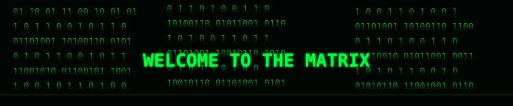
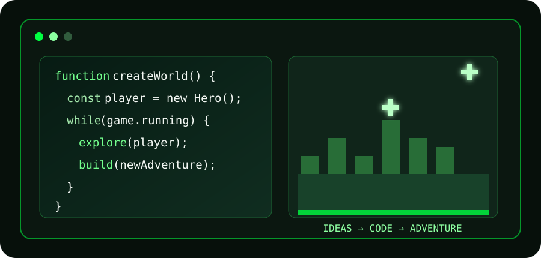
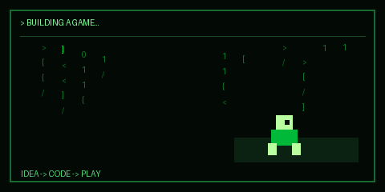
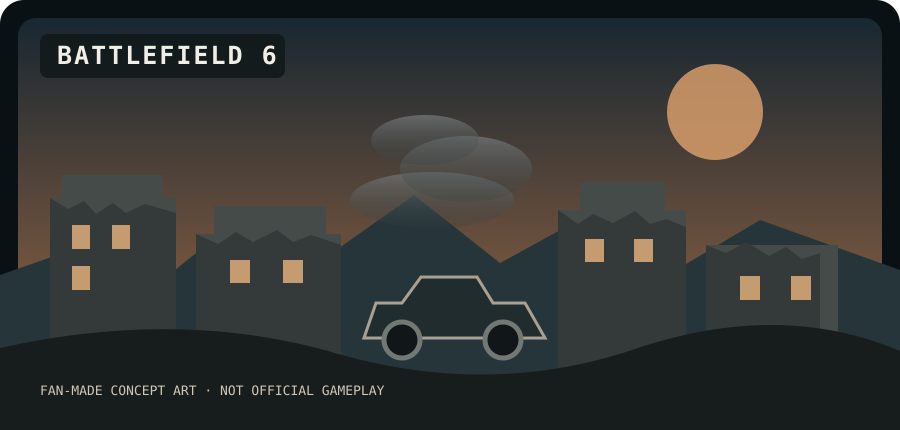
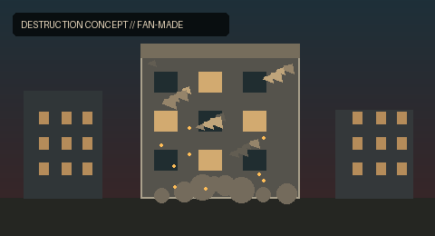

<div align="center">
  

  # `> HOLA, SOY FERNANDO JESUS SALAS CURIEL`

  **`[ SISTEMA INICIADO ]`** · `Entusiasta de los videojuegos` · `Jugando en PC`

  [Conoceme](https://www.linkedin.com/feed/)
</div>

---

## `> SOBRE MÍ`

Me gusta jugar en **PC** y soy un **entusiasta de la creación de videojuegos**: me interesa imaginar ideas, diseñar mundos y descubrir cómo se convierten en experiencias interactivas.

```text
> cargar_pasiones()
[ OK ] Gaming en PC
[ OK ] Entusiasmo por la creación de videojuegos
[ OK ] Aprender y crear cosas nuevas
```

<div align="center">
  
  <br>
  
</div>

## `> JUEGO FAVORITO: BATTLEFIELD 6`

Me gusta **Battlefield 6**, especialmente su acción a gran escala y los escenarios destructibles.

<div align="center">
  
  <br>
  
  <p><sub>Ilustración y animación originales, hechas para este perfil; no son imágenes ni gameplay oficial de Battlefield 6.</sub></p>
</div>

Más información del juego en el <a href="https://www.ea.com/games/battlefield/battlefield-6">sitio oficial de Battlefield 6</a>.

---

<div align="center">
  <code>01001000 01100001 01110000 01110000 01111001 00100000 01100111 01100001 01101101 01101001 01101110 01100111</code>
  <br>
  <sub>FIN DE LA TRANSMISIÓN // NOS VEMOS EN EL JUEGO</sub>
</div>
